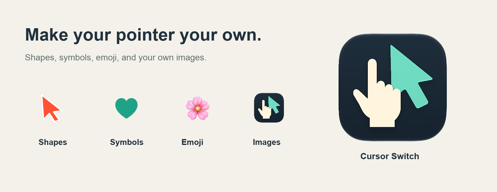

# Cursor Switch

Switch between your normal Mac pointer and a custom cursor, right from the menu bar.
Choose a shape, symbol, emoji, or your own image, then make it your size and color.

**[Download the latest beta](https://github.com/woodjosiah/Cursor-Switch/releases)**

Requires macOS 15 or newer. Works on Apple Silicon and Intel Macs.

## Install

1. Download and open the DMG.
2. Drag **Cursor Switch** to **Applications**, then eject the disk image.
3. Open Cursor Switch from Applications. Look for the cursor icon in your menu bar—there’s no Dock icon.

## Make it yours

Click the menu bar icon and choose **Customize…** to set up your cursor:

- Click or slide between shapes, symbols, emoji, and your own images. Built-in shapes include a Safari-style hand, and transparent images are supported.
- Adjust the size up to 120 pt and the available colors, with previews on light and dark backgrounds.
- Use **Top visible pixel** to align clicks with the tip of your cursor, or choose a manual click point.
- Highlight clicks with **Pulse ring** or **Ripple**, with your choice of size, color, and a distinct right-click style. Toggle **Show Clicks** from the menu bar.
- Turn on **Open at login** if you’d like Cursor Switch ready when you sign in.

Choose **Default** or **Custom** from the menu bar to switch, or press
**Control–Option–Command–C** from any app.

Your custom style is saved automatically. The app starts with your normal pointer,
and quitting restores it too.

## Updates and feedback

Choose **Check for Updates…** in the menu bar to get newer beta builds.

Custom cursors keep the same appearance over text and links. As this is a beta,
fullscreen apps and multiple displays may still have quirks.

Found an issue? [Send feedback](https://github.com/woodjosiah/Cursor-Switch/issues)
with your macOS version and a short description of what happened.

---

Developed with AI assistance using OpenAI Codex.

[Developer documentation](docs/DEVELOPMENT.md)
